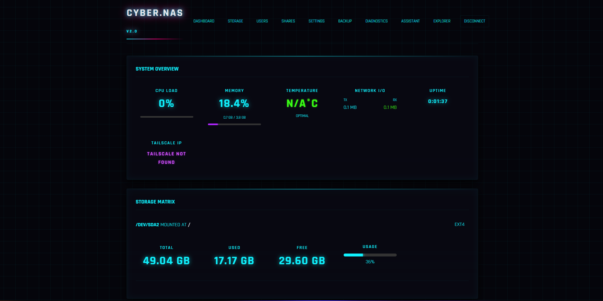
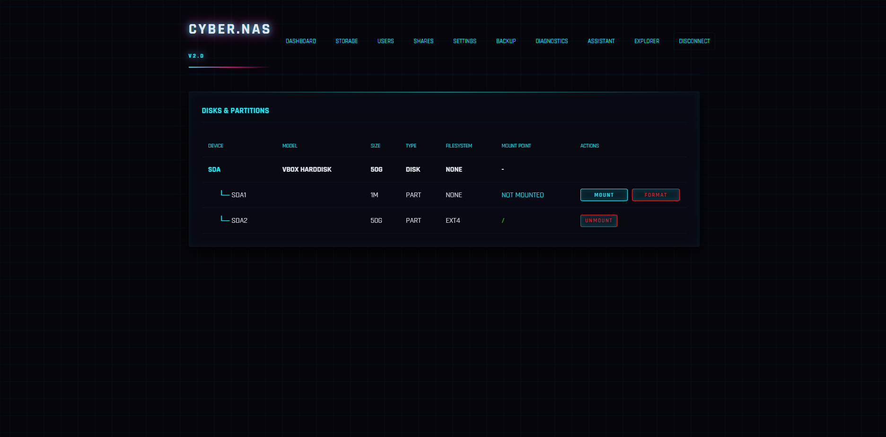
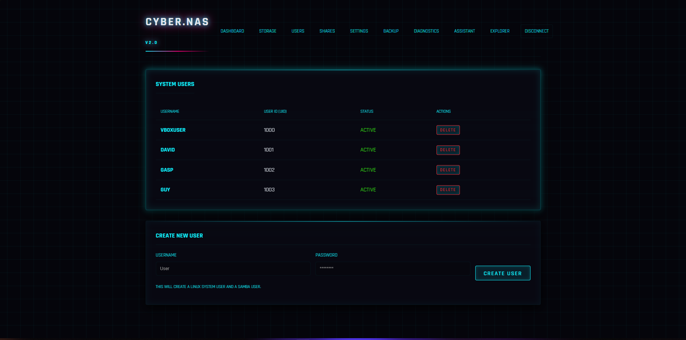
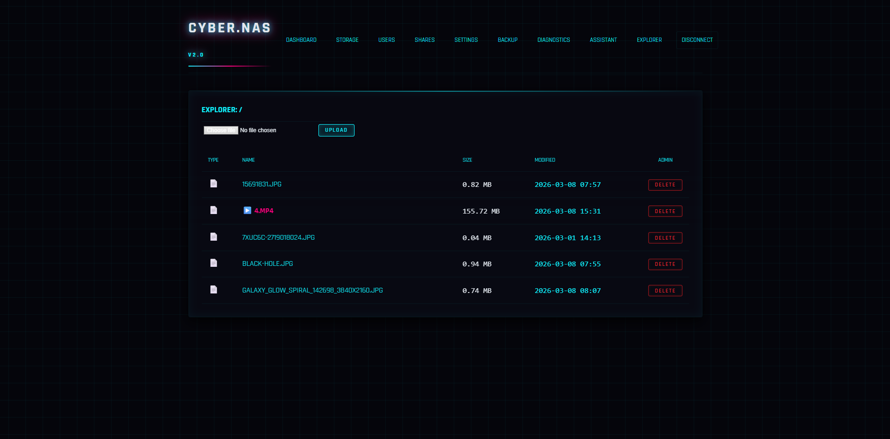
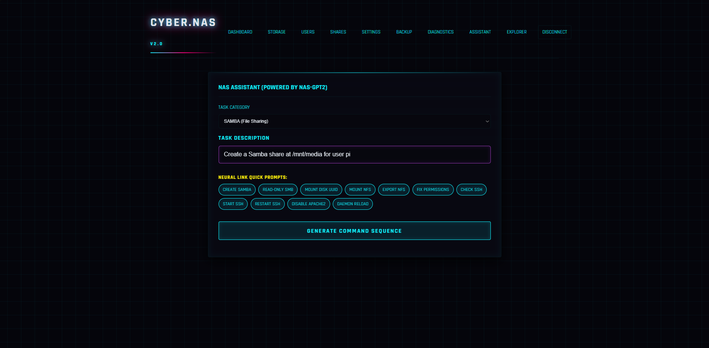
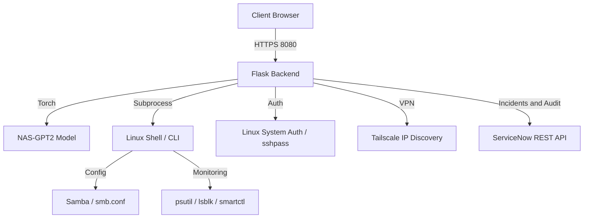

# Smol NAS AI

An autonomous AI-powered NAS management platform built for Ubuntu / Raspberry Pi, combining Samba storage administration with a locally hosted fine-tuned language model.

<div align="center">


</div>

**Project Goal:** Simplify server administration through a natural language interface and a streamlined web UI.

## Table of Contents

- [Overview](#overview)
- [Screenshots](#screenshots)
- [Features](#features)
- [System Architecture](#system-architecture)
- [AI Pipeline](#ai-pipeline)
- [Technology Stack](#technology-stack)
- [Requirements](#requirements)
- [Setup](#setup)
- [Configuration](#configuration)
- [Running the Application](#running-the-application)
- [Web Interface](#web-interface)
- [REST API](#rest-api)
- [Project Structure](#project-structure)
- [Troubleshooting](#troubleshooting)

## Overview

Smol NAS AI is an intelligent storage management platform that turns complex server administration into intuitive interactions. By combining a custom fine-tuned GPT-2 model with a Flask-based backend, Smol allows users to manage Samba shares, storage devices, system services, and user permissions from a browser - including through natural language instructions processed entirely on-device, with no internet connection required for inference.

Traditional NAS management requires deep CLI knowledge. Smol bridges this gap by providing:

1. **AI command generation** - A 250M parameter GPT-2 model trained specifically for NAS administrative commands, with one-click execution of the generated commands.
2. **Real-time system monitoring** - Live tracking of CPU, RAM, temperature (optimized for Raspberry Pi), network I/O, disk usage, and SMART drive health.
3. **Autonomous share management** - One-click Samba configuration, user delegation, and rsync-based backups.

## Screenshots

### Main Dashboard

<div align="center">
  
  <br/><sub>Centralized monitoring of system health, network traffic, and active Samba sessions.</sub>
</div>

### Management Modules

<table>
  <tr>
    <td align="center" width="50%">
      
      <br/><b>Storage and RAID</b>
      <br/><sub>Visual disk management: mount/unmount, format, and RAID status tracking via <code>lsblk</code>.</sub>
    </td>
    <td align="center" width="50%">
      
      <br/><b>User Controls</b>
      <br/><sub>Manage Linux and Samba users. Integration with <code>chpasswd</code> and <code>smbpasswd</code>.</sub>
    </td>
  </tr>
  <tr>
    <td align="center" width="50%">
      
      <br/><b>File Manager</b>
      <br/><sub>Web-based file management with integrated permission controls and media playback.</sub>
    </td>
    <td align="center" width="50%">
      
      <br/><b>AI Assistant</b>
      <br/><sub>Instruction-based command generation and execution. Ask "Create a Samba share" and receive the CLI command.</sub>
    </td>
  </tr>
</table>

## Features

| Module | Description | Access |
|---|---|---|
| **Dashboard** | CPU, RAM, temperature, network I/O, uptime, disk usage overview, active Samba sessions (via `smbstatus`), Tailscale IP discovery, and reboot/shutdown controls (administrator only). | All users |
| **Storage** | Block device listing through `lsblk`, mount points restricted to `/mnt` and `/srv`, device formatting (`ext4`, `ntfs`, `vfat`). | Admin |
| **Shares** | Create and delete Samba shares in `/etc/samba/smb.conf` with configurable valid users, read-only mode, and guest access; reloads `smbd` automatically. | Admin |
| **Samba Settings** | Edit global Samba parameters: workgroup, NetBIOS name, server protocol min/max, and guest account mapping. | Admin |
| **Users** | Add and remove Linux users (`useradd`, `userdel`, `chpasswd`) alongside Samba integration; protected system accounts cannot be deleted. | Admin |
| **Files** | Browse `/srv/nas`, upload, download, delete, and stream media (with byte-range requests for video playback). | All users |
| **AI Assistant** | Select a task category, describe the task in plain English, and receive executable CLI commands generated by the local GPT-2 model; commands can be executed directly from the interface. | Admin |
| **System Health** | SMART drive diagnostics (`smartctl`), service status for `smbd`, `nmbd`, and `ssh`, recent `journalctl` entries, and service start/stop/restart controls. | Admin |
| **Backup** | rsync-based backup jobs with optional dry-run mode and execution history. | Admin |
| **Signup** | Self-service registration that creates a Linux account (`useradd` + `chpasswd`) for standard (non-admin) users; usernames must be valid Linux login names, passwords at least 8 characters. | Public |

Authentication is role-based: the administrator signs in with the `NAS_USER` / `NAS_PASSWORD` credentials, while standard users authenticate against their real Linux accounts via `sshpass` over SSH on localhost.

## System Architecture



The server binds to `0.0.0.0:8080` with HTTPS (`ssl_context='adhoc'`). HTTPS is required because session cookies are configured with `SameSite=None; Secure` to allow the UI to be embedded in external iframes such as ServiceNow dashboards.

## AI Pipeline

### Custom NAS-GPT2 Model

The core of Smol is a GPT-2 model fine-tuned on a curated dataset of NAS administrative tasks. The model runs entirely locally through PyTorch and Hugging Face Transformers - no external API calls are made.

```python
# Inference logic (app.py and test.py)
inputs = tokenizer(prompt, return_tensors="pt").to(device)
outputs = model.generate(
    **inputs,
    max_new_tokens=150,
    temperature=0.2,
    top_p=0.85,
    repetition_penalty=1.1,
    pad_token_id=tokenizer.eos_token_id,
    eos_token_id=tokenizer.eos_token_id
)
```

Prompts follow a structured instruction format:

```
### Instruction:
Restart the Samba service completely

### Response:
```

The web assistant prepends a task category for organization, and the generated response is parsed into executable shell lines, rewritten for non-interactive `sudo -n` execution, and run server-side with a 120-second timeout.

### Command Categories

The evaluation suite (`test.py`) covers structured instructions across five domains:

- `[SAMBA]` - Share creation, user access, connection listing, and service restarts.
- `[RAID]` - Array status checks and disk expansion via `mdadm`.
- `[NFS]` - Export management and mount configurations.
- `[PERMISSION]` - `chown` and `chmod` generation.
- `[SERVICE]` - systemd service control and server reboots.

### Tokenizer

A custom ByteLevel BPE tokenizer (32,000 vocabulary) was trained on a NAS-focused corpus using `tokenizers` (`tokenizer/train_tokenizer.py`) and converted to Hugging Face format (`tokenizer/build_hf_tokenizer.py`). The final tokenizer lives in `tokenizer/nas_tokenizer_final/`.

### Quantized Inference

`nas_model_q8.gguf` is an 8-bit quantized build of the model for use with [llama.cpp](https://github.com/ggml-org/llama.cpp). The full vendored llama.cpp source tree is included under `llama_cpp_repo/` for building the inference runtime locally on the target hardware.

## Technology Stack

| Layer | Technology | Why |
|---|---|---|
| Backend | Flask, Flask-Login | Lightweight, session-based auth, ideal for embedded systems |
| AI / LLM | GPT-2 (250M, fine-tuned) | Fully local execution, no internet required for inference |
| ML framework | PyTorch + Transformers | Tokenization and generation for the GPT-2 head |
| System monitoring | psutil | Cross-platform CPU, RAM, temperature, network, and disk metrics |
| Storage interface | lsblk, mkfs, mount | Direct interaction with Linux block devices |
| Drive health | smartctl (smartmontools) | SMART diagnostics served to the Health page |
| Authentication | Flask-Login + sshpass | Session management with real Linux account verification |
| Backup | rsync | Reliable incremental file synchronization |
| Incident reporting | ServiceNow REST API | Automatic high-urgency incidents (e.g., disk above 90% usage, 1-hour cooldown) and audit-event logging |
| Networking | Tailscale | Remote access without port forwarding; IP auto-discovery |
| Optional runtime | llama.cpp (vendored) | Efficient GGUF inference for the quantized model |
| Frontend | Jinja2 templates + HTML/CSS | Minimal-overhead server-side rendering |

## Requirements

- Python 3.10 or newer
- Git LFS (repository weights are stored as LFS pointers)
- Ubuntu / Debian-class Linux (a Raspberry Pi deployment is the target use case)
- Sudo policy: privileged operations run non-interactively as `sudo -n`, so the service account must hold passwordless sudo for exactly the commands the NAS uses. Grant that minimal list via `visudo` — never grant blanket `NOPASSWD: ALL`:

  ```
  # Resolve the correct binary paths for your distro with: which useradd chpasswd ...
  <your-user> ALL=(ALL) NOPASSWD: \
      /usr/sbin/useradd, /usr/sbin/userdel, /usr/bin/chpasswd, /usr/bin/smbpasswd, \
      /bin/rm, /bin/mkdir, /bin/chmod, /bin/mount, /bin/umount, \
      /sbin/mkfs.ext4, /sbin/mkfs.ntfs, /sbin/mkfs.vfat, \
      /usr/bin/rsync, /usr/bin/smartctl, /usr/bin/lsblk, \
      /usr/bin/systemctl, /usr/bin/journalctl, \
      /sbin/reboot, /sbin/shutdown
  ```

### System packages (production)

```bash
sudo apt-get install samba sshpass smartmontools rsync
sudo apt-get install python3-openssl   # required for the ad-hoc HTTPS context
```

Tailscale is optional but recommended for remote access, and llama.cpp build dependencies (`gcc`, `cmake`) are only needed if you build the quantized GGUF runtime.

## Setup

1. **Clone the repository**

   ```bash
   git clone https://github.com/Vector3451/Smol.git
   cd Smol
   ```

2. **Install Python dependencies**

   ```bash
   pip install -r requirements.txt
   ```

3. **Pull model weights with Git LFS**

   ```bash
   git lfs pull
   ```

4. **Run the readiness diagnostic** (optional, production hosts)

   ```bash
   python3 NAS/diagnostic.py
   ```

   The diagnostic verifies that port 8080 is reachable, `pyOpenSSL` is installed, and pulls recent `nas-ui` service logs if available.

## Configuration

Copy `NAS/.env.example` to a real environment file (e.g. `/etc/nas/nas-ui.env`, referenced by `nas-ui.service`) and fill in your values. Never commit the real file.

| Variable | Purpose | Default |
|---|---|---|
| `SECRET_KEY` | Flask session signing key | Unset → random key generated at startup (sessions do not survive restarts; a warning is printed) |
| `NAS_USER` | Administrator username | `dev` |
| `NAS_PASSWORD` | Administrator password | `raspberry` (a warning is printed until this is set) |
| `NAS_ENV` | `production` (real system calls) or `development` (simulated/mock commands) | Set automatically: `production` on Linux, `development` on Windows |
| `SN_INSTANCE` | ServiceNow instance domain | `dev337329.service-now.com` |
| `SN_USER` | ServiceNow integration user | `admin` |
| `SN_PASS` | ServiceNow integration password | `dummy_password` (mock mode - incidents are only logged locally) |
| `SN_TLS_VERIFY` | Verify ServiceNow TLS certificates | `1` (set to `0` only for dev instances with self-signed certificates) |

> Security note: never deploy with the default secret, credentials, or `SN_PASS` left unchanged. All POST requests additionally require a CSRF token that is issued automatically to every form.

## Running the Application

### Option A - systemd service (recommended)

`NAS/nas-ui.service` registers the UI as the `nas-ui` service with automatic restart. Adjust `User` and `WorkingDirectory` to your host, then:

```bash
sudo cp NAS/nas-ui.service /etc/systemd/system/
sudo systemctl daemon-reload
sudo systemctl enable --now nas-ui
```

The UI then runs under HTTPS at `https://<host>:8080`.

### Option B - startup script

```bash
cd NAS
./run_nas.sh
```

The script activates the virtual environment if one exists, prints the Tailscale IP as a convenient access URL, and starts the app.

### Option C - manual launch

```bash
cd NAS
python app.py
```

## Web Interface

All pages are served from `https://<host>:8080`. The administrator dashboard is available at `/`, standard users land on the file manager at `/files`.

## REST API

| Endpoint | Method | Access | Description |
|---|---|---|---|
| `/api/status` | GET | Admin | System metrics, Samba status, and drive health in one payload |
| `/api/shares` | GET | Admin | Current Samba shares parsed from `smb.conf` |
| `/api/users` | GET | Admin | Linux users (UID >= 1000) |
| `/api/health/data` | GET | Admin | SMART diagnostics, service states, and recent journal entries |
| `/api/assistant/generate` | POST | Admin | Generate a command sequence from a task description |
| `/api/assistant/execute` | POST | Admin | Execute a generated command script server-side (unparseable or destructive sequences are rejected) |

## Project Structure

```text
Smol/
├── assets/screenshots/        README visual documentation
├── llama_cpp_repo/            Vendored llama.cpp source (GGUF inference runtime)
├── nas_model_250m/            Fine-tuned GPT-2 model and configs (Git LFS)
│   ├── config.json
│   ├── generation_config.json
│   └── model.safetensors
├── nas_model_q8.gguf          Quantized model for llama.cpp inference
├── tokenizer/
│   ├── build_hf_tokenizer.py  Convert raw tokenizer to Hugging Face format
│   ├── train_tokenizer.py     Train the ByteLevel BPE tokenizer (32k vocab)
│   └── nas_tokenizer_final/   Production tokenizer files
├── NAS/                       Core application logic
│   ├── app.py                 Flask entry point, routes, and system integration
│   ├── diagnostic.py          System readiness checker (port, OpenSSL, logs)
│   ├── nas-ui.service         systemd unit for the web UI service
│   ├── run_nas.sh             Startup script (venv activation, Tailscale IP)
│   ├── servicenow.py          ServiceNow incident and audit integration
│   ├── test_sn.py             ServiceNow connectivity test
│   └── templates/             Jinja2 HTML views (dashboard, storage, files,
│                              assistant, health, backup, shares, settings,
│                              users, login, signup, player, base)
├── requirements.txt           Python dependencies (pip install -r)
├── LICENSE                      MIT license
├── test.py                      Standalone model inference script
└── README.md
```

## Troubleshooting

- **Privileged operations fail with "sudo NOPASSWD not configured"** - Commands run as `sudo -n` and never prompt for a password. Grant the service user the minimal sudoers command list from the Requirements section via `visudo`.
- **Admin login works locally but not remotely** - The UI is HTTPS-only on port 8080 with `SameSite=None` cookies. Access it through the HTTPS URL (remember to trust the ad-hoc certificate) or via the Tailscale interface.
- **SMART data missing on the Health page** - Install `smartmontools` (`sudo apt install smartmontools`).
- **SSH login rejected for additional users** - Verify `sshpass` is installed and the target Linux users can SSH into localhost with a password.
- **Model failed to load** - Run `git lfs pull` from the repository root and confirm `nas_model_250m/model.safetensors` and the tokenizer files are present; the assistant page reports load status at startup.

## Support

Built for modern storage management. For questions, contact the repository owner or open an issue in this repository.
